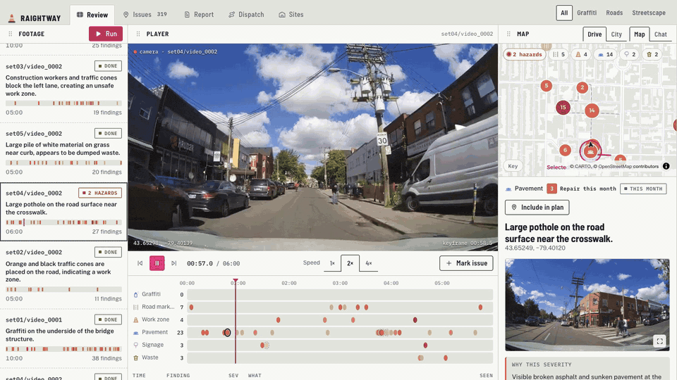
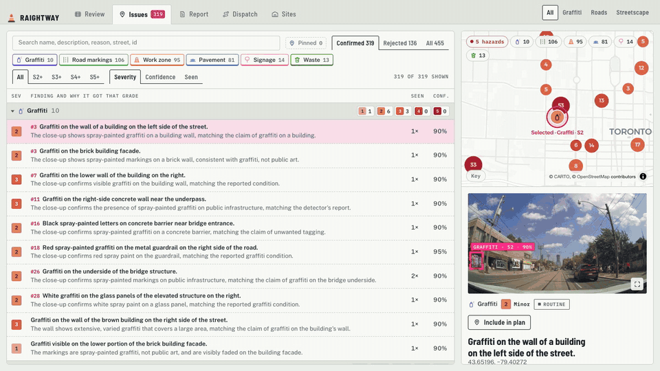
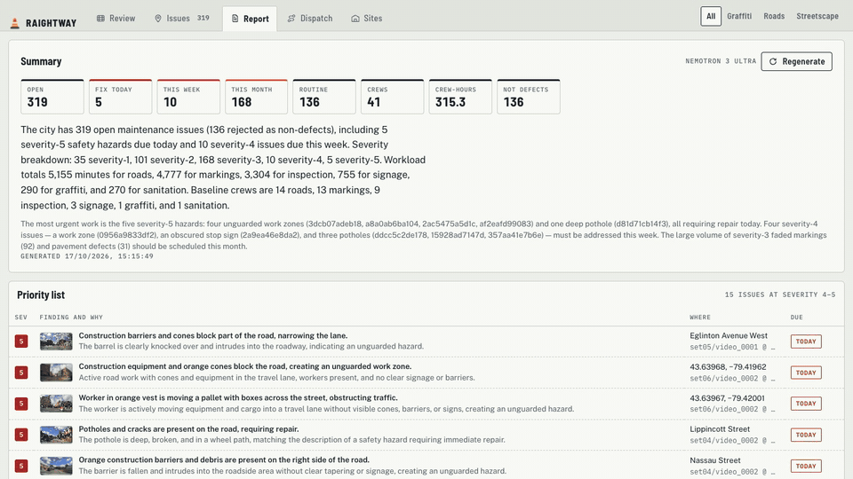
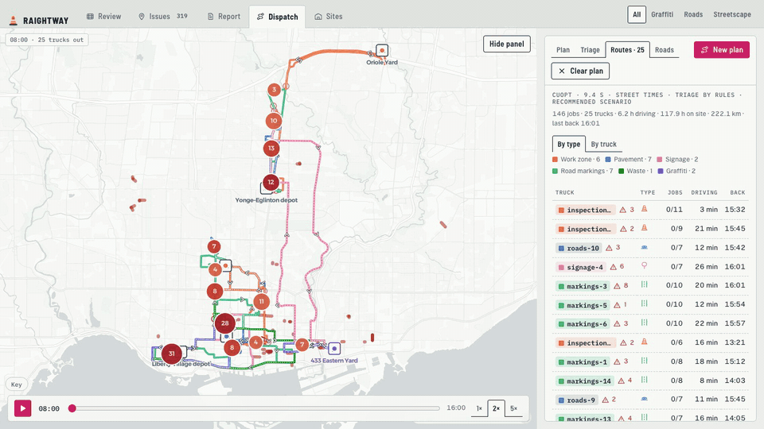
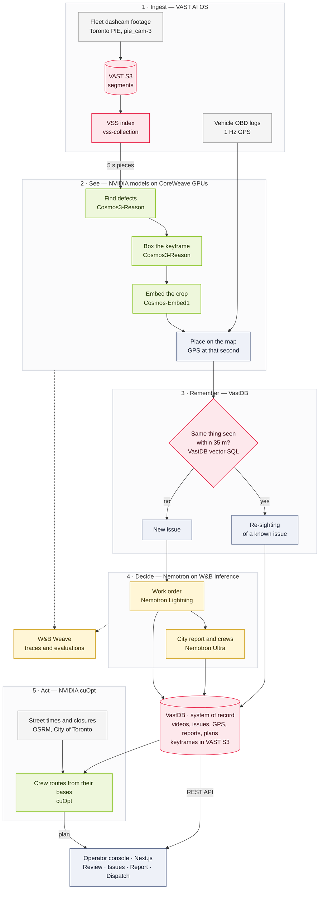

<div align="center">

# Raightway

**Fleets already film every street, every day. Raightway turns that footage into tomorrow's maintenance plan.**

It watches dashcam video, finds what a city would send a crew to fix, decides how to fix each one,
and routes the right crew to it, with every job linked to the frame that shows it.

[](frontend/)
[](backend/)
[](#sponsor-stack)
[](#sponsor-stack)
[](#sponsor-stack)
[](#sponsor-stack)

Built at the **VAST Builders Challenge**, London, 17 Oct 2026 · Track: *Real-time video agents*

</div>

---

## See it working

Screen recordings of the console running against the live backend on Toronto dashcam footage.

<div align="center">

| **Review** | **Issues** |
| :---: | :---: |
|  |  |
| Pick a drive and play it. Each finding is boxed on the frame Cosmos saw it in, laid out by category on the timeline, and pinned on the map as the vehicle drives past. | Every open issue across the city, ranked by severity. Open one to see its frame, work order, every sighting, and similar issues found by VastDB vector search. |

| **Report** | **Dispatch** |
| :---: | :---: |
|  |  |
| A situation report written by Nemotron: what was found, where, how urgent, and how many crews of each type tomorrow needs. | Set the crews, press **Plan routes**. cuOpt assigns every job to a crew from the right base and orders the stops, routed on real streets around the city's live road closures. Play the shift back to watch the crews move. |

| **Live analysis** |
| :---: |
|  |
| Press **Run**. Raightway re-reads the VAST index, fetches footage it hasn't analysed yet from VAST S3, and runs the whole pipeline on it live: findings pin themselves to the map as each 5 s piece is checked, re-sightings merge into known issues, and new ones get work orders. |

</div>

> Recordings go in [`docs/media/`](docs/media/); the list of shots to capture is in
> [`docs/media/README.md`](docs/media/README.md).

---

## The problem

Keeping streets in working order means finding and fixing a long tail of small problems: potholes,
graffiti, faded crossings, unsafe work zones, damaged signs, dumped rubbish. Cities find them in two
ways today, and both are poor:

- **Manual inspection** is slow and expensive, so most streets go months between visits.
- **311 complaints** are reactive and uneven. Issues get reported where people complain most, not
  where the need is greatest, and reports rarely say which crew or equipment the job needs.

Even once an issue is known, a planner still decides by hand **which crew goes where, in what order,
with what kit**, separately for each department.

Meanwhile buses, refuse trucks, delivery vans and autonomous vehicles film those same streets every
day, and that footage sits in storage, unwatched. Raightway needs no new sensors and no new staff:
the streets are already being filmed.

## What it does

| Step | What happens | Model or service |
|---|---|---|
| **See** | Each 5 s piece of footage is checked for six kinds of defect: pavement, graffiti, markings, work zones, signage, waste. Each finding gets a severity from 1 to 5 using a fixed rubric, a confidence and a short description. | NVIDIA **Cosmos3-Reason** |
| **Locate** | The finding is boxed on its keyframe and placed on the map from the vehicle's 1 Hz GPS log. | Cosmos3-Reason, PIE GPS |
| **Remember** | A crop of the finding is embedded. If the same thing was already seen within 35 m, it becomes a re-sighting of that issue instead of a new job. | NVIDIA **Cosmos-Embed1**, **VastDB** vector search |
| **Decide** | Every new issue gets a work order: the repair, the crew type, minutes on site, equipment and urgency. A city-wide report recommends how many crews of each type to send. | **Nemotron** on **W&B Inference** |
| **Act** | Jobs go to the nearest base of the right crew type. One solve orders every crew's stops within an 8-hour shift, routed on real streets around closures. | NVIDIA **cuOpt**, OSRM, City of Toronto road restrictions |

On the current corpus (16 drives, about 1.5 hours of footage) that is **469 open issues**, recommended to
**65 crews** across six crew types.

---

## Architecture



**How one piece of footage flows.** VSS hands over a 5 s piece and Cosmos3-Reason lists the defects in
it. Each finding is boxed on its keyframe (Nemotron Super-VL steps in if the box fails), its crop is
embedded by Cosmos-Embed1, and the GPS log at that second places it on the map. Dedupe checks the same
clip in memory first, then asks VastDB for the nearest known issues of the same category within about
35 m. A close match becomes a re-sighting; anything else is a new issue, and Nemotron writes its work
order. The backend's store keeps a local snapshot and writes to VastDB in the background, so a slow
database never blocks the console.

**Every integration has a fallback, and the console says which path answered.** If cuOpt is down,
dispatch uses a nearest-neighbour plan and the screen says *Fallback routing*. If VastDB search is
unreachable, similar issues come from an in-memory index and are labelled *local index*. A fallback is
never shown as the sponsor service. The full map of what calls what is in
[`backend/CLAUDE.md`](backend/CLAUDE.md#sponsor-integrations-what-calls-what-and-how-to-prove-it-ran).

The data contract is [`architecture.md` §4](architecture.md#4-data-contract) and the API is
[§5](architecture.md#5-api). The backend's pydantic models and the console's zod schemas are kept in step with both.

---

## Sponsor stack

The challenge's stack, layer by layer:

| Layer | Sponsor | What Raightway uses it for |
|---|---|---|
| **Coding agent** | SpaceXAI (Cursor) | Built with coding agents working in parallel from the briefs in [`agents/`](agents/) |
| **Agent runtime and platform** | **VAST Data** | VastDB as the system of record (videos, issues, GPS, reports, plans). VastDB vector SQL over ADBC for dedupe and similar issues. VAST S3 for keyframes. The VSS index (`vss-collection`) for the segment inventory, semantic search and clip download |
| **Model services** | **NVIDIA** | Cosmos3-Reason (find, box), Cosmos-Embed1 (vectors), Nemotron 3.5 Lightning (work orders), Nemotron 3 Ultra (report), Nemotron 3.5 Super-VL (box fallback), cuOpt (crew routing) |
| | **CoreWeave** | The GPUs serving the Cosmos models |
| | **Weights & Biases** | W&B Inference serves Nemotron. Weave traces every model call (text only, never media) and runs the evaluations in [`scripts/weave_eval.py`](scripts/weave_eval.py) |

---

## Inputs and outputs

**In:**
- `pie_cam-3` dashcam segments from the [PIE dataset](https://data.nvision2.eecs.yorku.ca/PIE_dataset/) (Toronto, 1080p), pre-ingested into VSS: 1080 segments over sets `set01`–`set06`.
- The matching vehicle OBD logs (`annotations_vehicle/*_obd.xml`), turned into 1 Hz GPS by `scripts/load_gps.py`.

**Out** (shapes in [`architecture.md` §4](architecture.md#4-data-contract)):

| Output | Shape | Example |
|---|---|---|
| Issue | category, severity 1–5, confidence, description, normalised bbox, lat/lon, sightings, `duplicate_of` | `signage · S4 · 95% · "Stop sign partially obscured by graffiti" · 43.71676, -79.40310` |
| Work order | repair, crew, minutes, equipment, urgency | `Fill pothole with asphalt patch and compact surface · roads · 75 min · routine` |
| Report | summary, counts by category and severity, recommended crews, rationale | `markings 178, pavement 119 … → roads 22, markings 22, inspection 11 …` |
| Plan | per crew: base, ordered stops, ETAs, street path, road warnings, run sheet; `solver: cuopt` or `fallback` | |

---

## Evaluation

| What | Command | Checks |
|---|---|---|
| Work orders | `.venv/bin/python ../scripts/weave_eval.py orders --limit 20` | Nemotron covers every issue, minutes are plausible for the category, equipment is listed. Needs no labels. Results land in the W&B project |
| Issue finding | `.venv/bin/python ../scripts/weave_eval.py find --labels <file.jsonl>` | Cosmos category precision and recall on hand-labelled clips, and whether clean clips stay clean |
| Live services | `python -m app.ai.gatecheck`, `python -m app.vast.gatecheck`, `python -m app.planning.cuopt --toy` | Each model endpoint, VastDB tables, ADBC vector search and cuOpt, with timings |
| Backend | `cd backend && python3 -m pytest -q` | Offline: dispatch, closures, category routing, search-path reporting, trace redaction |
| Console | `pnpm check` | Typecheck, lint, and unit tests for the contract parsers, HTTP client and sample data |

<!-- Paste the Weave evaluation link and headline scores here once run. -->

---

## Run it

**On sample data** (no backend, no credentials):

```bash
pnpm install --dir frontend
pnpm dev:mock                 # http://localhost:3000
```

**Against the real backend.** The backend runs on the workshop VM, where VastDB, VAST S3, the VSS API and
the GPU endpoints are reachable. Credentials are read from `/config` on the VM and never leave it.

```bash
# on the VM
cd backend && ./run.sh        # uvicorn on :8000

# on your laptop: starts the VM backend if needed, tunnels it to :8001 and runs the console
pnpm dev
```

| Command (repo root) | What it does |
|---|---|
| `pnpm dev` | VM backend + SSH tunnel + console, with a reconnect watchdog |
| `pnpm dev:mock` | Console on built-in sample data |
| `pnpm check` | Typecheck, lint and test the console |
| `pnpm backend:status` · `backend:restart` · `backend:logs` | Manage the uvicorn on the VM |

Populate the corpus once: build the inventory (`scripts/build_inventory.py`) and the GPS
(`scripts/load_gps.py`), then either `POST /api/admin/precompute/start` or import a Cosmos sweep with
`scripts/import_sweep.py`.

---

## API

| Route | Returns |
|---|---|
| `GET /api/videos` · `GET /api/videos/{id}` | Drives with live progress; one drive with all its findings |
| `POST /api/run` | Analyse the next footage in the VAST index that hasn't been analysed yet, live |
| `POST /api/videos` | Upload a clip; analysis starts |
| `GET /api/issues` | Open issues across the city |
| `GET /api/issues/{id}/similar` | Nearest issues by VastDB vector search, with distance and which index answered |
| `GET /api/frames/{id}` | The keyframe JPEG |
| `GET` · `POST /api/report` | Latest report; regenerate it |
| `POST /api/dispatch` | A crew plan for the given crew counts |
| `GET /api/facilities` · `GET /api/hazards` · `POST /api/directions` | Crew bases, road alerts, a route between two points around closures |
| `GET /api/health` | Up, and whether the store loaded from VastDB |

---

## Repo layout

```
.
├── backend/                FastAPI + pipeline (runs on the VM)
│   ├── app/ai/             Cosmos, Cosmos-Embed1, Nemotron clients, prompts, Weave tracing
│   ├── app/vast/           VastDB tables, ADBC vector search, VAST S3 media
│   ├── app/pipeline/       piece → dedupe → live analysis, corpus pre-compute, VSS client
│   ├── app/planning/       dispatch (cuOpt), report, road closures, crew bases
│   ├── app/geo/            GPS, segment inventory, OSRM road times
│   └── tests/              offline pytest
├── frontend/               pnpm workspace
│   ├── apps/web/           Next.js 16 operator console
│   └── packages/core/      contract types, zod schemas, HTTP client, sample city
├── scripts/                inventory, GPS, demo clips, sweep import, Weave evals
├── agents/                 the build-day workstream briefs
├── docs/                   design directions, README media
└── architecture.md         the system, data contract (§4) and API (§5)
```

Notes for coding agents are in [`CLAUDE.md`](CLAUDE.md), [`backend/CLAUDE.md`](backend/CLAUDE.md) and
[`frontend/CLAUDE.md`](frontend/CLAUDE.md).

---

## Limitations

- **One city, one camera.** The corpus is Toronto PIE footage from a single forward camera. Side-of-road
  defects out of frame are missed.
- **Cosmos is conservative.** It is told that most clips have no defect, so it under-reports rather than
  invents. Recall on small defects is the weak point; the `find` evaluation measures it.
- **Dedupe is location-first.** Two different defects of the same category within 35 m can merge when
  their crops look alike.
- **Crew bases are partly assumed.** Sanitation's seven transfer stations come from City of Toronto open
  data. The three works yards for the other crews have no public address, so their locations are
  stand-ins, flagged `assumed` in [`facilities.json`](backend/app/planning/facilities.json).
- **Routing uses the public OSRM server**, which is rate-limited; plans fall back to straight-line times
  when it is unavailable, and the console says so.

---

## Team

Harrish Ayyanar · Afthab Shiraz
